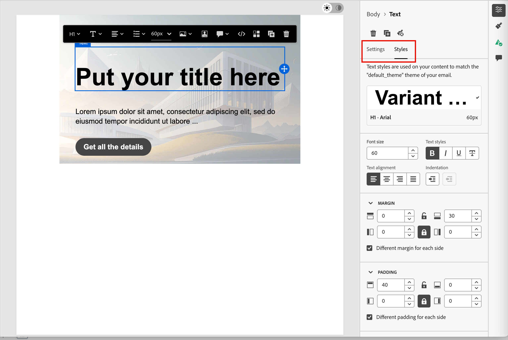

# Criação de conteúdo - módulos

Use os [módulos de conteúdo](../user-guide/content/content-modules.md) para criar seu design a partir de seções preparadas, como cabeçalhos, banners, cartões e rodapés. Cada módulo inclui estrutura, estilo e conteúdo padrão que você pode personalizar.

1. No espaço de design visual, selecione a guia **[!UICONTROL Módulos]** se ela não estiver visível.

   {width="500" zoomable="yes"}

1. Procure as categorias ou use o campo de pesquisa para localizar um módulo por nome.

   Expanda uma categoria para revisar suas variantes de layout.

1. Arraste uma variante de módulo para a tela.

   {width="650" zoomable="yes"}

1. Selecione os elementos no módulo para substituir o texto, as imagens e os links padrão pelo seu próprio conteúdo.

1. Use as guias **[!UICONTROL Configurações]** e **[!UICONTROL Estilos]** para personalizar o componente selecionado.

   {width="650" zoomable="yes"}

   Para adicionar mais conteúdo ao módulo, selecione a guia **[!UICONTROL Componentes]** e arraste um componente de conteúdo para o módulo.
