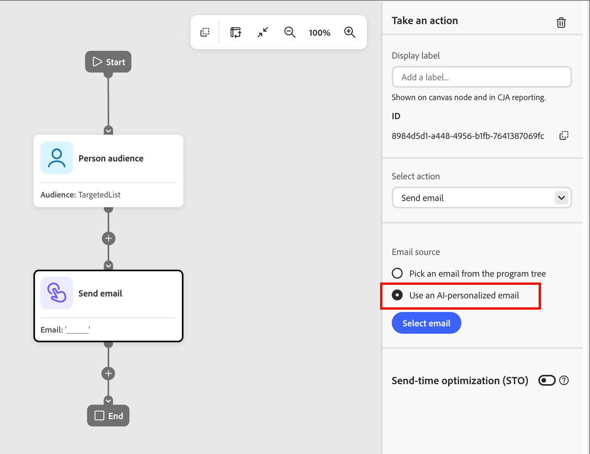

# Personalizar conteúdo de email por persona

A habilidade _Personalization de conteúdo_ transforma um email em variantes com base em persona e informações de dados, assim você não precisa criar um email separado para cada público. Em vez de enviar uma mensagem após um evento, a habilidade resolve o público-alvo em coortes [persona derivadas](../audiences/personas.md), supera insights e gera variantes personalizadas. Cada variante é salva como conteúdo condicional em um único email, para que cada pessoa receba automaticamente a versão que corresponde à sua persona quando uma jornada a enviar.

* **Habilidade** - `content-personalization`
* **Chamada** - Na [interface de chat](./chat-interface.md), descreva um público-alvo para um novo email ou selecione **[!UICONTROL Personalizar email]** ou **[!UICONTROL Analisar email]** no menu _Mais_ de um rascunho [de email na árvore de programas](../marketing/email-channel.md#personalize-analyze)
* **Leituras/gravações em** - [!DNL Marketo Optimizer]

## Principais conceitos {#key-concepts}

| Termo | Definição |
| --- | --- |
| **Coorte de personalidades** | Um grupo de pessoas que compartilham uma [pessoa derivada](../audiences/personas.md), como _CXO/EVP_ ou _Colaborador Individual_. |
| **Segmento** | Um grupo de pessoas definidas por qualquer critério, como perfil, setor ou nível de envolvimento. Um coorte de persona é um segmento definido especificamente pelo persona derivado compartilhado. |
| **Grupo de destino** | O público-alvo que você descreve em linguagem natural. A habilidade o transforma em coortes de persona correspondentes. |
| **Insight** | Uma descoberta com base em dados sobre mensagens, posicionamento ou tom com melhor desempenho para um coorte de persona, retirada de seus próprios dados. |
| **Variante** | Uma versão personalizada das seções de email que você optou por personalizar, gerada para uma coorte personalizada. |
| **Email personalizado de IA** | O email único salvo que agrupa todas as variantes como [conteúdo condicional](../content/conditional-content.md) blocos. |
| **Auditoria de email** | Uma revisão de um email existente em relação a cada segmento do grupo-alvo, mostrando o que corresponde e o que deve ser aprimorado para cada persona antes de personalizar. |

## Pré-requisitos {#prerequisites}

* Acesso a [!DNL Marketo Optimizer] com [!DNL CX Coworker] habilitado.
* [Personalidades derivadas](../audiences/personas.md) resolvidas em seus dados. A habilidade depende dessas classificações para criar coortes de persona. O suporte personalizado está planejado para uma versão futura.
* Dados históricos suficientes para insights. Se os insights não estiverem disponíveis para um coorte de persona, a habilidade informará que os dados são insuficientes e recorrerá às práticas recomendadas gerais para esse persona.
* Um [modelo de email](../content/templates.md) ou um [email](../marketing/email-channel.md) de rascunho existente em um programa.
* Uma jornada de [pessoa](../marketing/person-journeys.md) que contém o nó da ação _Enviar Email_ usado para entregar o email personalizado.

## Criar e personalizar um email a partir de um modelo {#create-personalize-from-template}

Esse fluxo cria um novo email e o personaliza na mesma conversa.

1. **Chame a `/content-personalization` habilidade** na interface de chat [!DNL Coworker].

1. **Forneça o conteúdo.**

   Faça upload de um resumo de conteúdo ou descreva o conteúdo desejado em linguagem natural.

1. **Selecione um modelo** da biblioteca [de modelos](../content/templates.md).

1. **Revise o rascunho.**

   [!DNL Coworker] mapeia seu conteúdo para o modelo e produz um email de rascunho. É possível fazer edições de texto básicas em linha.

   >[!WARNING]
   >
   >Somente as edições de texto básicas ficam disponíveis em linha durante a criação. Para edições avançadas, salve o email e abra-o no [espaço de design visual](../content/email-authoring.md).

1. **Descreva o grupo alvo** em linguagem natural.

1. **Revise os coortes de persona resolvidos**.

   O [!DNL Coworker] inspeciona seus dados e retorna os coortes de persona que correspondem à sua descrição, com uma contagem para cada um. Revise a descrição do grupo-alvo e tente novamente se necessário.

1. **Confirmar o grupo alvo**.

   Em seguida, [!DNL Coworker] recupera insights para cada coorte de persona resolvida.

1. **Selecione as seções a serem personalizadas**, como a linha de assunto ou uma seção de corpo, e revise as variantes geradas.

   Regenerar uma variante se ela não couber. O número de coortes de persona não é fixo. Depende do grupo de destino e dos dados.

1. **Salve o email**.

   Todas as variantes são armazenadas em um email personalizado de IA, não como emails separados.

<!-- screenshot: Coworker chat panel showing the resolved persona cohorts with counts, and the "Personalized variants" review grid -->

## Analisar um email existente {#analyze-existing-email}

A ferramenta _Analisar_ está disponível somente para emails de rascunho. Depois que um email é publicado, ele não pode ser alterado. Na árvore de programas, clique no ícone _Mais_ (**...**) ao lado de um rascunho de [email](../marketing/email-channel.md#manage-emails) e escolha **[!UICONTROL Analisar email]**.

{width="400"}

Para executar uma auditoria de e-mail:

1. **Descreva o grupo alvo** que deseja personalizar em termos de persona.

   Por exemplo, _Pessoas nas funções de Marketing_ ou _Pessoas nas funções de Liderança_.

1. **Revise a auditoria de email.**

   O [!DNL Coworker] resolve sua descrição em segmentos de persona e mostra um cartão de **Auditoria de email** listando cada segmento e, em seguida, revisa o email em relação a cada um para destacar o que está correto e o que deve ser melhorado.

1. [!DNL Coworker] pergunta o que fazer em seguida, incluindo **[!UICONTROL Ver auditoria seção por seção]** e **[!UICONTROL Personalizar este email]**.

1. Selecione **[!UICONTROL Ver auditoria seção a seção]** para abrir uma exibição de **_Análise de email_** com um seletor de persona e recomendações específicas para cada seção.

   Cada seção mostra quantas alterações são recomendadas e cada persona mostra uma contagem de recomendações, como `4 recommendations for SVP/VP`. Você também pode aplicar as recomendações diretamente inserindo _personalizar_ no chat.

1. Na auditoria, selecione **[!UICONTROL Personalizar este email]** para aplicar os insights e gerar variantes.

   Consulte a seção a seguir, [_Personalizar um email existente_](#personalize-existing-email).

<!-- screenshot: Email analysis view with persona selector, per-section "N changes" badges, and "what needs work" recommendations -->

## Personalizar um email existente {#personalize-existing-email}

Selecione **[!UICONTROL Personalizar email]** no menu _Mais_ de um rascunho de email na árvore de programas, ou continue em uma [auditoria de email](#analyze-existing-email) para personalizar um email que você já criou.

1. **Revise os coortes de persona resolvidos.**

   O [!DNL Coworker] inspeciona seus dados e retorna os coortes de persona que correspondem à sua descrição, com uma contagem para cada um. Revise a descrição do grupo-alvo e tente novamente se necessário.

   Se você chegou a esta etapa a partir de uma auditoria de email, [!DNL Coworker] continua diretamente a partir dos insights de auditoria.

1. **Selecione as seções a serem personalizadas** na visualização de email, como a linha de assunto e seções de conteúdo específicas, e confirme.

1. **Revise as variantes geradas.**

   As variantes também podem variar por setor, como um CXO em serviços de saúde versus serviços financeiros. [!DNL Coworker] apresenta uma grade **[!UICONTROL Variantes personalizadas]**, um cartão por coorte personalizada, com uma linha de assunto, título, corpo e uma opção **[!UICONTROL Visualizar]**.

   Selecione o ícone _Informações_ em um cartão para ver a insight dessa variante (a persona em que ela se baseia e a insight de envolvimento que a informou) e gerar novamente uma variante, se necessário.

   Você pode filtrar a grade por persona.

1. **Salvar o conjunto.**

   Clique em **[!UICONTROL Salvar]** e confirme. [!DNL Coworker] confirma que o email agora está disponível na Biblioteca de IA e pergunta se também deve aplicar as alterações ao email original, que o atualiza no local.

<!-- screenshot: "Personalized variants" grid showing persona cards with subject, headline, body, Preview, and the info-icon insight tooltip -->

## Saída salva e uso em uma jornada {#saved-output}

Qualquer que seja o fluxo do qual você comece, a personalização produz um único _email personalizado para IA_ armazenado na Biblioteca de IA. O email contém [conteúdo condicional](../content/conditional-content.md) blocos com chave por persona. Para editar seções, abra-as no [espaço de design visual](../content/email-authoring.md) e para visualizar como é resolvido cada bloco com chave personalizada, use **[!UICONTROL Simular Conteúdo]**.

Para usar o email em uma jornada, adicione um [nó Enviar Email](../marketing/action-nodes.md) e selecione **[!UICONTROL Usar um email personalizado por IA]**.

{width="450"}

Em seguida, escolha o email salvo. Aplique sua configuração e regras de negócios ao nó como de costume.

## Comportamento de tempo de execução {#run-time-behavior}

Você seleciona o único email personalizado de IA na jornada, não uma variante por público-alvo. Quando a jornada é executada, o email é resolvido automaticamente para a variante que corresponde à persona de cada destinatário. Você não escolhe uma variante por recipient.

## Limitações {#limitations}

| Limitação | Detalhe |
| --- | --- |
| **Personalidades** | Ainda não suportado. A habilidade classifica coortes de persona somente a partir de [personas derivadas](../audiences/personas.md) predefinidas. |
| **Dados insuficientes para insights** | Se os seus dados não forem compatíveis com uma insight para uma coorte de persona, a habilidade declara isso e retorna às práticas recomendadas gerais para essa persona. |
| **Edição em linha durante a criação** | Somente edições de texto básicas estarão disponíveis em linha quando você [criar e personalizar um email a partir de um modelo](#create-personalize-from-template). Edições avançadas exigem o [espaço de design visual](../content/email-authoring.md). |
| **Ponto inicial necessário** | A personalização de um email requer um modelo ou um email de rascunho existente em um programa. |
