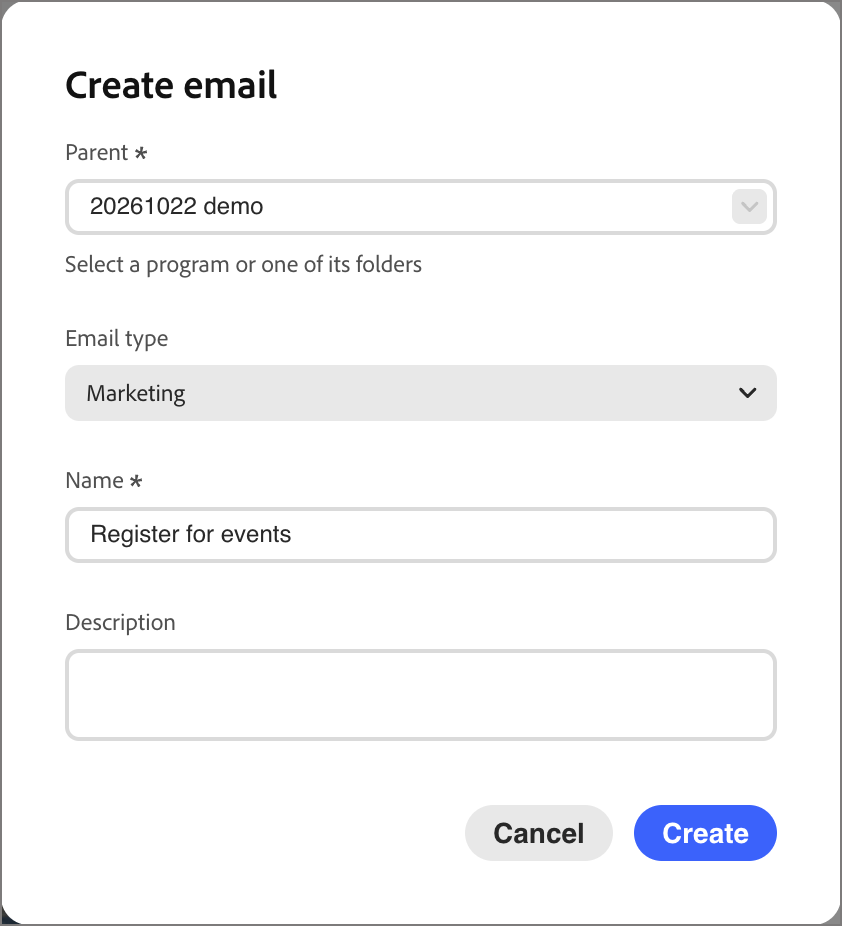
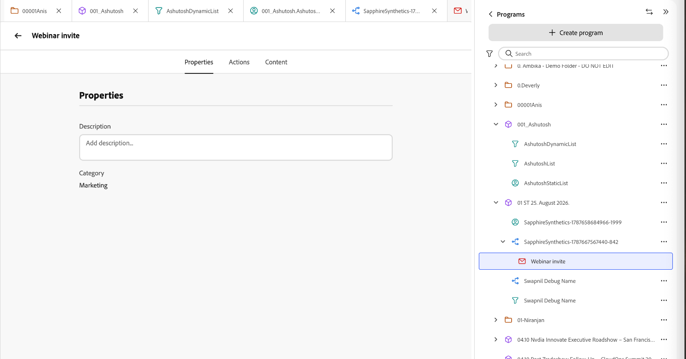
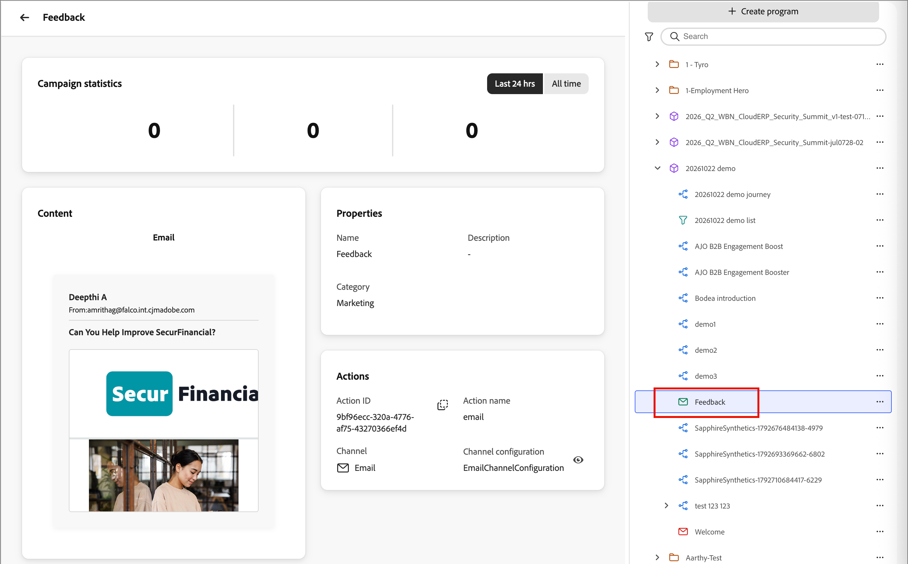

# Criar emails e adicioná-los às jornadas

O [!DNL Adobe Marketo Optimizer] traz uma experiência moderna de criação e entrega de email de nível empresarial para os profissionais de marketing B2B, para que você possa criar, publicar e enviar emails de seus programas e jornadas.

Os emails são ativos independentes, portanto, você não precisa de uma jornada para criar um. [Crie um email](#create-email-from-programs) dentro de um programa ou de uma de suas pastas, [publique-o](#publish-email) quando estiver pronto e [envie-o a partir de qualquer jornada nesse programa](#add-email-from-journey).

## Ciclo de vida do email {#lifecycle}

Um email está sempre em um dos seguintes estados:

| Estado | Descrição |
| ----- | ----------- |
| **Rascunho** | Cada novo email começa como um rascunho, que é mostrado com um ícone de envelope vermelho na árvore de programas. Você pode editar suas propriedades, ações e conteúdo, além de personalizar, analisar, renomear ou excluí-lo. |
| **Publicado** | Um email publicado está bloqueado e pronto para ser enviado, e é mostrado com um ícone de envelope verde. Ele não pode ser editado ou despublicado, e é listado ao escolher um email em uma jornada. |
| **Em uma jornada** | Quando você seleciona um email publicado em uma ação _Enviar email_, uma cópia publicada que pertence à jornada é criada. A cópia é somente leitura e não é alterada se o original for duplicado e revisado posteriormente. |

Um email muda de rascunho para publicado quando você o publica. Quando selecionada para um nó de ação _Enviar email_, uma cópia reside na jornada. Para alterar um email publicado, [duplique-o](#duplicate-email). A duplicata é criada como um rascunho com o mesmo conteúdo e configurações.

{width="800" zoomable="yes"}

O estado do email determina a disponibilidade da ação:

| Ação | Rascunho | Publicado | Em uma jornada |
| ------ | ----- | --------- | ------------ |
| Editar propriedades, ações e conteúdo | Sim | Não | Não |
| Personalizar email | Sim | Não | Não |
| Analisar email | Sim | Não | Não |
| Publicação | Sim, depois que os alertas de bloqueio forem resolvidos | Já publicado | Publicado automaticamente |
| Duplicar | Sim | Sim | Não |
| Renomear | Sim | Não | Não. Você nomeia a cópia ao selecioná-la. |
| Excluir | Sim | Não | Não. Exclua o nó _Enviar email_. |
| Selecionar em uma jornada | Não | Sim | Não aplicável |

## Pré-requisitos {#before-you-begin}

Certifique-se de que sua função de usuário inclua as [permissões de produto](../start/permissions-reference.md) a seguir para as tarefas que você executar:

* **[!UICONTROL Exibir Programas B2B]** e **[!UICONTROL Exibir Pastas B2B]** - Exibir os programas e pastas em que os emails residem.
* **[!UICONTROL Exibir Emails B2B]** - Exibir mensagens de email.
* **[!UICONTROL Gerenciar emails B2B]** - Criar, editar, duplicar, renomear, excluir e publicar emails.
* **[!UICONTROL Gerenciar Jornadas de Pessoas B2B]** - Adicionar ou substituir ações de email em uma jornada de pessoas. Para acesso somente leitura a jornadas, use **[!UICONTROL Exibir Jornadas de pessoas B2B]**.
* **[!UICONTROL Gerenciar Experiência de Conversação B2B]** - Acesse [!DNL Coworker] para personalizar ou analisar um email. As ações em [!DNL Coworker] também exigem as permissões de email correspondentes.

Permissões adicionais são necessárias somente se você executar essas tarefas relacionadas de configuração ou envio:

* **[!UICONTROL Gerenciar programas B2B]** - Crie um programa se um ainda não existir.
* **[!UICONTROL Gerenciar configurações de canais B2B]** e **[!UICONTROL Exibir configurações de email B2B]** - Criar uma configuração de canal de email. Os administradores também precisam **[!UICONTROL Gerenciar configurações de email B2B]** para definir as configurações de entrega de email.
* **[!UICONTROL Publicar Jornadas de pessoas B2B]** - Publique a jornada que envia o email.

Antes de criar um email, confirme o seguinte:

* Os emails residem em um programa ou em uma de suas pastas. Defina o programa antes de criar um email. Uma jornada só pode enviar emails de seu próprio programa.
* Para selecionar uma configuração de canal de email, use a guia **[!UICONTROL Ações]** do email. Administradores gerenciam a [configuração do canal de email](../admin/email-channel-configuration.md).
* Você pode criar quantos emails forem necessários em um programa.

>[!NOTE]
>
>Se você estiver enviando um email pela primeira vez, verifique se a [capacidade de entrega de emails](../start/email-deliverability.md) e o [canal de email](../admin/email-channel-configuration.md) necessário estão configurados.

<!-- 
* **Email channel configurations** - Manage the sender identity, reply behavior, marketing vs. transactional message types, and tracking.
* **Email deliverability controls** - Set up your email deliverability channel, including subdomain delegation (Fully Delegated and CNAME methods), DMARC, SPF/DKIM auto-configuration, and shared IP pool support.
* **Send Email action** - From a journey, add a _Send email_ action node, including personalization using profile attributes (Handlebars syntax).
* **Visual drag-and-drop email design tools** -  Design your email content with structures, content components, themes, dark-mode support, and reusable visual fragments.
* **Marketo Design Studio assets** — Choose images and assets from a one-time copy of your Marketo Engage asset library directly inside the email canvas.
* **Reusable templates and fragments** — Save common headers, footers, CTAs, and full email layouts and reuse them across journeys.
* **Role-Based Access Control (RBAC)** — Apply granular permissions for creating, editing, approving, and sending email. 
-->

>[!BEGINSHADEBOX]

## Limitações atuais {#limitations}

* **Perfis de teste, Simular conteúdo e Enviar prova** não estão disponíveis na versão atual. A renderização de Litmus e os relatórios de spam baseados no SpamAssassin estão planejados para uma versão futura.
* **A personalização em nível de conta e os dados de objeto personalizado** não estão disponíveis na versão atual. Use atributos de perfil.
* A **migração automatizada do Velocity para Handlebars** dos [!DNL Marketo Engage] modelos existentes está disponível mediante solicitação.
* **Colaboração e comentários de email** (comentários incorporados, @mentions, fluxo de trabalho de solicitação-revisão) estão planejados para uma versão futura.
* As **integrações dos Fragmentos de conteúdo do AEM Assets, AEM e Adobe Express** estão planejadas para uma versão futura.

>[!ENDSHADEBOX]

## Principais conceitos {#key-concepts}

Antes de criar emails para jornadas de pessoas e criar conteúdo de email, analise estes conceitos:

| Conceito | Em [!DNL Adobe Marketo Optimizer] |
| ------- | ---------------------- |
| **_[Espaço de design de email](../content/email-authoring.md#email-design-tools)_** | A tela visual e as ferramentas de design usadas para compor conteúdo de email. Ele inclui componentes de layout de arrastar e soltar, templates, fragmentos, temas e um editor de personalização. |
| **_[Modelo](../content/templates.md)_** | Um layout de email reutilizável que está disponível para criar um novo email. Ele pode ser um modelo integrado fornecido pelo Adobe ou um modelo personalizado criado pela sua equipe. |
| **_[Fragmento visual](../content/fragments.md)_** | Um bloco reutilizável de conteúdo (como cabeçalho, rodapé, CTA, aviso de isenção legal) que pode ser inserido em vários emails. A atualização de um fragmento propaga a alteração para cada email que o utiliza. |
| **_[Tema](../content/email-authoring.md#design-from-scratch)_** | Uma predefinição de estilo reutilizável (cores, tipografia, espaçamento, estilos de botão) aplicada em um email. |
| **_[token do Personalization](../content/personalization-expressions.md)_** | Uma expressão Handlebars — por exemplo, `{{profile.firstName}}` — resolvida no momento do envio usando os dados de perfil de cada recipient. |
| **_[Email autônomo](#lifecycle)_** | Um ativo de email que existe independentemente de qualquer jornada. Ela é criada em um programa ou em uma de suas pastas e é movida de rascunho para publicado. |
| **_[Tipo de email](#email-types)_** | A classificação escolhida ao criar um email, **[!UICONTROL Marketing]** ou **[!UICONTROL Transacional]**. Informa ao [!DNL Marketo Optimizer] como tratar a mensagem para fins de consentimento. |
| **_[Ação Enviar email](./action-nodes.md#add-an-action-node)_** | O nó de ação de jornada que usa uma configuração de canal e conteúdo de email para entregar um email. |

## Tipos de email {#email-types}

Ao criar um email, você escolhe o tipo dele. O tipo informa a [!DNL Marketo Optimizer] como tratar a mensagem para fins de consentimento. Portanto, escolha a que corresponde ao motivo pelo qual você está enviando.

| Tipo | Usar para |
| ---- | ------- |
| **[!UICONTROL Marketing]** | Mensagens promocionais, como um anúncio de lançamento de produto, um boletim informativo ou um convite de evento. |
| **[!UICONTROL Transacional]** | Mensagens operacionais que uma pessoa espera devido a algo que fez, como um pedido, registro ou confirmação de remessa. |

O tipo aparece como o email **[!UICONTROL Categoria]** na guia **[!UICONTROL Propriedades]**.

## Criar um email na árvore de programas {#create-email-from-programs}

Crie um email em um programa ou pasta para criá-lo independentemente de qualquer jornada.

1. Na navegação à esquerda, expanda **[!UICONTROL Gerenciamento de marketing]** e selecione **[!UICONTROL Programas]**.

1. Na árvore de programas, clique no ícone _Mais_ (**...**) ao lado do programa ou pasta onde deseja criar o email e selecione **[!UICONTROL Criar email]**.

   {width="400"}

1. Na caixa de diálogo _[!UICONTROL Criar email]_, preencha os seguintes campos:

   * **[!UICONTROL Pai]** - (Obrigatório) O programa ou pasta onde o email foi salvo. É definido como o programa a partir do qual você iniciou e você pode alterá-lo para outro programa ou para uma das pastas do programa.

   * **[!UICONTROL Tipo de email]** - Selecione **[!UICONTROL Marketing]** ou **[!UICONTROL Transacional]** (consulte [Tipos de email](#email-types)).

   * **[!UICONTROL Nome]** - (Obrigatório) Digite um nome que identifique o email na árvore de programas.

   * **[!UICONTROL Descrição]** - (Opcional) Insira uma observação para sua equipe sobre o email e sua finalidade.

   {width="400"}

1. Clique em **[!UICONTROL Criar]**.

O email é aberto em sua própria guia e aparece sob o programa na árvore de programas como um rascunho. Enquanto um email está aberto, qualquer [!DNL Coworker] prompt tem escopo para esse email.

Em seguida, [configure o email](#define-email-properties), [resolva qualquer alerta](#alerts) e [publique-o](#publish-email).

### Definir propriedades e ações de email {#define-email-properties}

Um email de rascunho tem três guias: **[!UICONTROL Propriedades]**, **[!UICONTROL Ações]** e **[!UICONTROL Conteúdo]**. Corrija-as na ordem e salve as alterações. A página de e-mail é aberta ao criar um e-mail na árvore de programas. Para abrir um rascunho posteriormente, selecione o email na árvore de programas.

#### Preencha as guias Propriedades e Ações {#properties-actions-tabs}

1. (Opcional) Na guia **[!UICONTROL Propriedades]**, insira uma **[!UICONTROL Descrição]** e qualquer outra informação descritiva que você deseja capturar para o email.

   {width="800" zoomable="yes"}

1. Selecione a guia **[!UICONTROL Ações]** e conclua as configurações funcionais do email:

   * **[!UICONTROL Email]** - Selecione ou crie uma **[!UICONTROL Configuração de canal de email]** para usar.

     Esse é o conjunto reutilizável de configurações de entrega de email que define a identidade do remetente, o endereço de resposta, o subdomínio, o pool de IPs, o tipo de email (marketing ou transacional) e o rastreamento. Clique no ícone _Exibir_ para examinar as configurações da configuração selecionada.

     Os administradores criam configurações em [Configuração do canal de email](../admin/email-channel-configuration.md).

   * **[!UICONTROL Regras de negócio]** - (Opcional) Aplique regras de limite ou período de silêncio à sua ação de email selecionando um conjunto de regras.

     Para obter mais informações sobre regras de negócios e como definir e ativar conjuntos de regras para comunicações de canal, consulte [_Regras de negócios_](../admin/business-rules.md).

   * **[!UICONTROL Rastreamento de ação]** - Marque as caixas de seleção das ações que deseja rastrear para o email.

   {width="600" zoomable="yes"}

#### Adicionar a linha de assunto e o conteúdo {#content-tab}

1. Clique em **[!UICONTROL Editar conteúdo]** ou selecione a guia **[!UICONTROL Conteúdo]**.

   {width="500" zoomable="yes"}

1. Insira o texto da **[!UICONTROL Linha de assunto]** que você deseja exibir no campo de assunto do email.

   A linha de assunto é obrigatória.

   Clique no ícone _Personalizar_ (  ) para usar um token de personalização no campo.

1. (Opcional) Marque a caixa de seleção **[!UICONTROL Otimizar o tamanho do HTML]** para reduzir o tamanho do HTML de email durante o processo de publicação.

   Isso ajuda a impedir o recorte de emails em clientes como o Gmail. O Gmail trunca mensagens com mais de 100 KB. Consulte [_Otimizar o tamanho do HTML de email_](#optimize-html-size) para obter mais informações.

1. Clique em **[!UICONTROL Editar corpo do email]** para acessar as ferramentas de design visual e começar a [criar seu conteúdo](../content/email-authoring.md).

   Como alternativa, você pode clicar em **[!UICONTROL Editor de código]** para codificar seu próprio conteúdo em HTML simples. Se você tiver um HTML existente para reutilizar em seu design de email, é possível copiá-lo e colá-lo no editor.

### Verificar alertas {#alerts}

O botão **[!UICONTROL Alertas]** no cabeçalho do email mostra quantos problemas [!DNL Adobe Marketo Optimizer] foram encontrados. Clique para exibir a lista.

{width="450"}

Os alertas têm dois tipos:

* **Problemas de bloqueio** - Enquanto qualquer um desses problemas persistir, a **[!UICONTROL Publicação]** não estará disponível, e o menu _Mais_ do email mostrará **[!UICONTROL Resolver alertas de email para publicação]**. Resolva todos os problemas de bloqueio antes de publicar o email.

  São exemplos:

  * O nome do remetente está vazio
  * Linha de assunto ausente
  * O conteúdo do email está vazio

* **Avisos** - Apontam itens que merecem ser revisados, mas não impedem que você publique. Um email pode mostrar um alerta e ainda ser publicado se os alertas restantes forem avisos.

  São exemplos:

  * O link para opção de não participação não está presente no corpo do email
  * A versão de texto do HTML está vazia
  * Links vazios detectados
  * Email excede 100 K

## Gerenciar emails na árvore de programas {#manage-emails}

Os emails são exibidos na árvore de programas com um ícone de envelope. Um envelope vermelho marca um rascunho. Um envelope verde marca um email publicado. Clique no ícone _Mais_ (**...**) ao lado de um email para gerenciá-lo.

{width="400"}

O menu de um email de rascunho inclui **[!UICONTROL Publicar]**, **[!UICONTROL Personalizar email]**, **[!UICONTROL Analisar email]**, **[!UICONTROL Duplicar]**, **[!UICONTROL Renomear]** e **[!UICONTROL Excluir]**.

Para um email publicado, **[!UICONTROL Duplicar]** é a única opção.

### Personalizar e analisar um email {#personalize-analyze}

Embora um email seja um rascunho, seu menu _Mais_ inclui duas ferramentas de conteúdo. Execute-as antes de publicar, pois um email publicado não pode ser alterado.

* **[!UICONTROL Personalizar email]** - Abre [!DNL Coworker] com o email carregado. Para adicionar conteúdo personalizado ao email, descreva o grupo-alvo. Consulte [_Personalizar conteúdo de email por persona_](../agents/personalize-content.md) para obter mais informações.

  {width="700" zoomable="yes"}

* **[!UICONTROL Analisar email]** - Analisa o conteúdo que você já criou. Consulte [Analisar um email existente](../agents/personalize-content.md#analyze-existing-email).

### Publicar um email {#publish-email}

Publicar um email quando ele estiver pronto para ser enviado. Somente os emails publicados são listados quando você [seleciona um email em uma jornada](#add-email-from-journey).

1. Verifique se o email não tem [alertas](#alerts) de bloqueio.

1. Na árvore de programas, clique no ícone _Mais_ (**...**) ao lado do email e selecione **[!UICONTROL Publicar]**.

1. No diálogo de confirmação _[!UICONTROL Publicar email]_, clique em **[!UICONTROL Publicar]**.

   {width="400"}

O ícone de email fica verde. Se você selecionar o email, ele será aberto em uma visualização somente leitura que resume seu conteúdo, propriedades e ações.

{width="700" zoomable="yes"}

>[!IMPORTANT]
>
>A publicação é permanente. Um email publicado não pode ser editado, renomeado, excluído nem retornado a rascunho. Para fazer alterações, [duplique o email](#duplicate-email).

### Duplicação de um email {#duplicate-email}

Para alterar um email publicado, duplique-o. Para tentar uma variação sem alterar o original, também é possível duplicar um rascunho.

1. Na árvore de programas, clique no ícone _Mais_ (**...**) ao lado do email e selecione **[!UICONTROL Duplicar]**.

1. Na caixa de diálogo _[!UICONTROL Duplicar email]_, altere o **[!UICONTROL Nome]**, se necessário.

   O padrão é o nome original seguido por `_copy`. Opcionalmente, adicione uma **[!UICONTROL Descrição]**.

   {width="400"}

1. Clique em **[!UICONTROL Duplicar]**.

A duplicata é criada como um rascunho com o mesmo conteúdo e configurações. Faça as alterações e publique-as.

## Adicionar um email a uma jornada {#add-email-from-journey}

Para enviar um email, adicione-o a uma jornada no mesmo programa. Quando você seleciona um email, o [!DNL Marketo Optimizer] faz uma cópia dele para essa jornada e publica a cópia automaticamente. Os emails vêm da árvore de programas; portanto, [crie e publique o email](#create-email-from-programs) primeiro.

Você pode usar o mesmo email em mais de uma jornada. Cada vez que você a seleciona, uma cópia separada é criada para essa jornada e você pode dar a cada cópia um nome exclusivo.

### Selecionar um email para uma ação Enviar email {#select-email-in-journey}

1. Abra a jornada e selecione ou adicione um nó [_Executar uma ação_](action-nodes.md#add-an-action-node).

1. Em _[!UICONTROL Selecionar ação]_, escolha **[!UICONTROL Enviar email]**.

1. Em _[!UICONTROL Origem do email]_, escolha uma das seguintes opções:

   * **[!UICONTROL Escolher um email da árvore de programas]** - Escolha esta opção para usar um email publicado do programa da jornada ou de suas pastas.

   * **[!UICONTROL Usar um email personalizado com IA]** - Escolha esta opção para usar um email gerado com IA. Esses emails são otimizados para que os clientes da caixa de entrada assistida por IA fundamentem seus resumos e respostas em suas ofertas e planos de ação.

   {width="600"}

   O nó mostra um nome de email em branco até que você escolha um email.

1. Clique em **[!UICONTROL Selecionar email]**.

   * Email da árvore do **_Programa:_** Na caixa de diálogo _[!UICONTROL Selecionar email]_, localize e selecione o email.

     Use o **[!UICONTROL Email de pesquisa]** para filtrar se necessário. Selecione um email na lista para visualizá-lo e verifique a linha de assunto.

     {width="600" zoomable="yes"}

     >[!NOTE]
     >
     >A caixa de diálogo lista somente os emails publicados do programa de jornada e suas pastas. Os rascunhos não aparecem até que você [publique-os](#publish-email). Se um email não for exibido, verifique se ele tem um publicado (ícone verde) e se está localizado no programa correto.

     Em **[!UICONTROL Name]**, digite o nome que o email deve ter dentro da jornada.

     O padrão é o nome original seguido por `_copy`. Renomeie-o para algo que faça sentido no contexto da jornada.

   * **_Email personalizado com IA:_** Na caixa de diálogo _[!UICONTROL Selecionar um email gerado por IA]_, localize e selecione o email personalizado.

     Selecione um email personalizado na lista. A caixa de diálogo lista os _emails personalizados de IA_ armazenados na Biblioteca de IA. Para obter mais informações, consulte Personalizar conteúdo de email por persona.

     {width="450" zoomable="yes"}

1. Clique em **[!UICONTROL Selecionar]**.

### Jornada cópia de email {#journey-copy}

A cópia é adicionada à jornada, publicada e listada na jornada da árvore de programas com um ícone laranja. Ele tem sua própria ID de ação e é somente leitura.

{width="700" zoomable="yes"}

A jornada mantém sua própria cópia. O conteúdo e a configuração são copiados no momento em que você seleciona o email. Posteriormente, se você duplicar e revisar o original, as jornadas existentes continuarão a enviar a versão copiada.

Para a [otimização de tempo de envio](email-send-time-optimization.md) opcional, configure o nó de ação de jornada depois de selecionar o email.

### Atualizar um email em uma jornada {#update-email-in-journey}

Como a cópia da jornada é somente leitura, você a substitui em vez de editá-la.

1. [Duplique](#duplicate-email) o email publicado original, faça suas alterações no rascunho e [publique-o](#publish-email).

1. Na jornada, selecione o nó _Enviar email_ e exclua-o usando o ícone de lixeira no painel _Realizar uma ação_.

1. Adicione uma nova ação _Enviar email_ em seu lugar e selecione o email atualizado.

## Otimizar o tamanho do HTML de email {#optimize-html-size}

>[!CONTEXTUALHELP]
>id="ajo-b2b-prime_email_minification"
>title="Reduzir tamanho do HTML"
>abstract="Ative esta opção para compactar o código HTML do seu email durante a publicação, removendo espaços em branco desnecessários, recuos e comentários não essenciais. Isso ajuda a impedir o recorte de emails em clientes como o Gmail. O Gmail trunca mensagens com mais de 100 KB."

O [!DNL Marketo Optimizer] permite compactar a versão do HTML de email durante o processo de publicação removendo espaços em branco, recuos e comentários não essenciais desnecessários. Manter o tamanho pequeno do HTML ajuda a:

* Evite **recorte de email** — alguns clientes, como o Gmail, truncam mensagens com mais de ~100 KB, impedindo que os destinatários visualizem o conteúdo completo.
* Melhore o **tempo de carregamento do email** na caixa de entrada do destinatário.
* Melhore a **deliverability** e reduza o uso da largura de banda.

Essa otimização não é aplicada automaticamente — você deve habilitá-la na guia _[!UICONTROL Conteúdo]_.

<!--  -->

>[!IMPORTANT]
>
> A redução de tamanho do HTML é aplicada somente no momento da publicação.

A otimização é segura para o cliente de email:

* Preserva comentários condicionais do MSO/Outlook.
* Isso não altera seu conteúdo, imagens ou vídeos reais.

>[!NOTE]
>
>A redução no tamanho do email depende da estrutura original do HTML do email. Se o conteúdo já estiver compacto ou a carga do email for muito grande, a redução pode ser mínima e pode não impedir totalmente o recorte.

<!-- 
Proof and simulate workflows are not available in this release. See [Current limitations](#limitations).

### Test HTML size optimization {#optimize-html-proof}

If you have enabled the [HTML size optimization](#optimize-html-size) option, you can evaluate its impact before publishing when sending proofs. Follow the following steps.

1. In the email design space, click the _Issues_ icon on the top right. If the rendered email size exceeds 100 KB, a message is displayed to warn you that this may cause truncation in some email clients.

1. Click **[!UICONTROL Simulate content]**.

1. To test the optimized version, click the **[!UICONTROL Send proof]** button and select the **[!UICONTROL Optimize HTML size]** option. This will send a proof with the reduced HTML size to your test recipients.

    >[!NOTE]
    >
    >This setting is independent from the email editor — the proof reflects what you select in the proof, regardless of whether the option is enabled or disabled in the email itself.

1. Select the test recipients and click **[!UICONTROL Send proof]**.

1. Back in the **[!UICONTROL Simulate]** screen, click the **[!UICONTROL View Proof]** button.

1. Click the _Information_ icon next to the status of the proof.

   The optimization details are displayed in a pop-up window, including the original HTML size, the optimized HTML size, and the size reduction percentage.
    
    Use this information to validate the optimized output and confirm the email stays within the recommended 100 KB threshold before publishing.

-->
