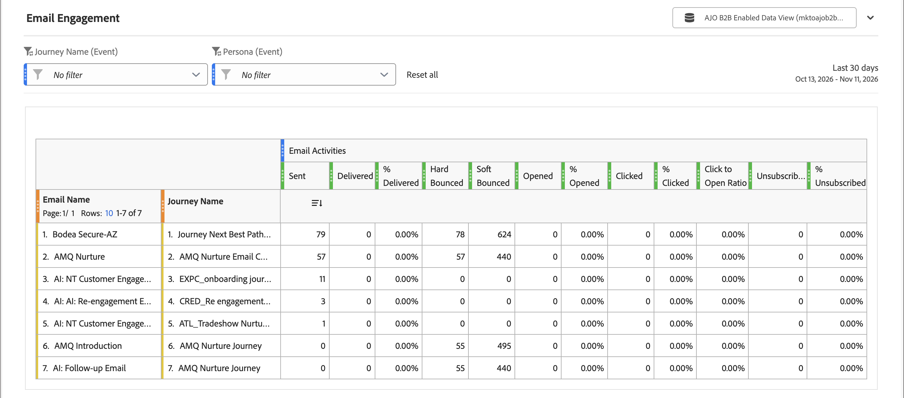
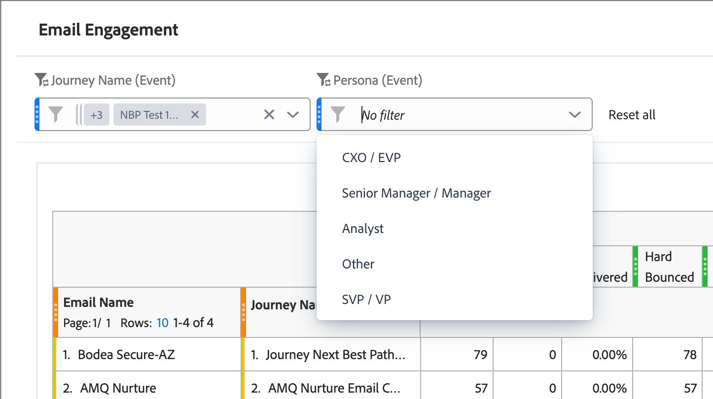

# Relatório de engajamento com o email

<!-- SPHR-32511: Filter by Program, Filter by Audience, and the program data point for the email performance table are not documented here pending delivery. -->

Use o relatório [!UICONTROL Envolvimento de email] para analisar a capacidade de entrega de emails e o desempenho de engajamento em sua instância, detalhado por email e jornada.

_Para exibir o relatório :_

1. Na navegação à esquerda, selecione **[!UICONTROL Relatórios]**.
1. Clique no ícone _Lista_ (  ) e selecione **[!UICONTROL Envolvimento de email]** no painel _[!UICONTROL Índice]_.

{width="700" zoomable="yes"}

Use os filtros **[!UICONTROL Nome da Jornada (Evento)]** e **[!UICONTROL Persona (Evento)]** na parte superior do relatório para restringir os dados de email. Abra uma lista de filtros e selecione os valores que serão incluídos. Consulte [Filtros](#filters).

Você pode [alterar o intervalo de datas](./reports-overview.md#change-the-date-range) usando o mesmo seletor de intervalo de datas disponível em outras seções de relatório.

Selecione **[!UICONTROL Compartilhar]** na parte superior do relatório para baixar ou agendar uma exportação de todos os dados do relatório. Consulte [_Exportar um relatório_](./reports-overview.md#export-a-report) na visão geral de Relatórios.

## Tabela de relatório {#report-table}

O relatório [!UICONTROL Envolvimento de email] mostra uma linha para cada email, com as seguintes dimensões de linha.

* **[!UICONTROL Nome do email]** - O nome do email.
* **[!UICONTROL Nome da Jornada]** - O nome da jornada que enviou o email.

Colunas de métrica estão agrupadas em **[!UICONTROL Atividades de email]**.

| Coluna | Descrição |
| --- | --- |
| [!UICONTROL Enviado] | Número de emails enviados. |
| [!UICONTROL Entregue] | Número de emails entregues. |
| [!UICONTROL % Entregue] | Porcentagem de emails enviados que foram entregues. |
| [!UICONTROL Devolvido(s) Fortemente] | Número de emails que falharam permanentemente na entrega. |
| [!UICONTROL Devolvido(S) Temporariamente] | Número de emails que falharam temporariamente na entrega. |
| [!UICONTROL Aberto] | Número de vezes que os destinatários abriram o email. |
| [!UICONTROL % Aberto] | Porcentagem de emails entregues que foram abertos. |
| [!UICONTROL Clicado] | Número de vezes que os recipients clicaram em um link no email. |
| [!UICONTROL % de cliques] | Porcentagem de emails entregues que receberam um clique. |
| [!UICONTROL Clique para Abrir Proporção] | Porcentagem de emails abertos que receberam um clique. |
| [!UICONTROL Cancelamento de assinatura] | Número de destinatários que cancelaram a inscrição no email. |
| [!UICONTROL % cancelado(s)] | Porcentagem de emails entregues que resultaram em um cancelamento de inscrição. |

## Filtros {#filters}

Use filtros para restringir o relatório por jornada ou persona.

* **[!UICONTROL Nome da Jornada (Evento)]** - Filtre pela jornada que enviou o email. O padrão é [!UICONTROL Nenhum filtro].
* **[!UICONTROL Pessoa (Evento)]** - Filtre pela [pessoa derivada](../audiences/personas.md#filter-by-derived-persona) associada ao email. O padrão é [!UICONTROL Nenhum filtro].

{width="500" zoomable="yes"}

Selecione **[!UICONTROL Redefinir tudo]** para limpar todos os filtros e retornar ao modo de exibição padrão.