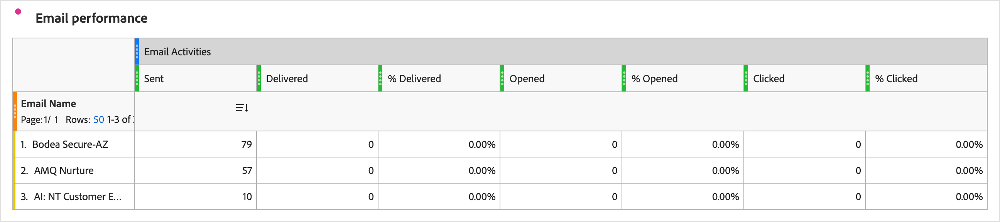

# Relatório de detalhes da Jornada da pessoa

<!-- SPHR-39120: UX plans to move the Journey activity flow tile to the top of the report. Update the tile order in this page when that ships. -->

Clique em **[!UICONTROL Exibir relatório]** para uma jornada de pessoa ao vivo ou concluída para ver suas métricas de desempenho e o fluxo de atividades. Depois de abrir o relatório, é possível selecionar várias jornadas para incluir no relatório.

>[!PREREQUISITES]
>
>Para exibir este relatório, você deve ter a **[!UICONTROL permissão [Exibir relatórios de Jornada de pessoas B2B]**](../start/permissions-reference.md).

_Para exibir o relatório :_

1. Abra uma jornada de pessoas **[!UICONTROL Ao Vivo]** ou **[!UICONTROL Concluída]** na lista _[!UICONTROL jornadas de pessoas]_.
1. No cabeçalho da jornada, selecione **[!UICONTROL Exibir Relatório]**.

   {width="600" zoomable="yes"}

Você pode [alterar o intervalo de datas](./reports-overview.md#change-the-date-range) do relatório.

Selecione **[!UICONTROL Compartilhar]** na parte superior do relatório para baixar ou agendar uma exportação dos dados. Consulte [_Exportar um relatório_](./reports-overview.md#export-a-report) na visão geral de Relatórios.

{width="700" zoomable="yes"}

## Filtros {#filters}

Inicialmente, o relatório mostra a jornada da qual você a abriu. Use os filtros na parte superior do relatório para alterar quais jornadas e personalidades estão incluídas.

* **[!UICONTROL Nome da Jornada (Evento)]** - Predefinido para a jornada da qual você abriu o relatório. Abra a lista de filtros e selecione as jornadas a serem incluídas. Você pode selecionar várias jornadas.
* **[!UICONTROL Persona (Evento)]** - Filtre o relatório para pessoas que correspondam a um [perfil derivado](../audiences/personas.md#filter-by-derived-persona) específico. O padrão é [!UICONTROL Nenhum filtro].

{width="700" zoomable="yes"}

Para filtrar por persona, abra a lista de filtros **[!UICONTROL Persona (Evento)]** na parte superior do relatório e selecione os valores a serem incluídos.

Selecione **[!UICONTROL Redefinir tudo]** para redefinir os filtros de relatório.

## Status pessoal e envolvimento {#person-status-and-engagement}

Esta seção apresenta quatro blocos:

* **[!UICONTROL Status das pessoas na jornada]** - Divide as pessoas na jornada em _[!UICONTROL Concluídas]_ e _[!UICONTROL Em andamento]_ categorias, com as porcentagens correspondentes.
* **[!UICONTROL Pessoas concluídas ao longo do tempo]** - Um gráfico de linhas que controla o número de pessoas que concluíram a jornada durante o intervalo de datas selecionado.
* **[!UICONTROL Pessoas envolvidas vs. não envolvidas]** - Divide as pessoas na jornada em _[!UICONTROL Envolvidas]_ e _[!UICONTROL Não envolvidas]_ categorias, com as porcentagens correspondentes.
* **[!UICONTROL Pessoas envolvidas]** - O número total de pessoas qualificadas como envolvidas na jornada.

## Desempenho do email {#email-performance}

A tabela de [!UICONTROL Desempenho do email] mostra as métricas de entrega e envolvimento para cada email enviado na jornada. Para obter as mesmas métricas de email em todas as jornadas, consulte o [relatório de Engajamento no Email](./email-engagement-report.md).

{width="700" zoomable="yes"}

Colunas da tabela de [!UICONTROL Desempenho do email]:

* [!UICONTROL Nome do email] - Nome do email.
* [!UICONTROL Enviado] - Número de emails enviados.
* [!UICONTROL Entregues] - Número de emails entregues.
* [!UICONTROL % Entregue] - Número de emails entregues dividido pelo número enviado.
* [!UICONTROL Aberto] - Número de vezes que os destinatários abriram o email.
* [!UICONTROL % aberto] - Número de emails abertos dividido pelo número entregue.
* [!UICONTROL Clicado] - Número de vezes que os destinatários clicaram em um link no email.
* [!UICONTROL % de cliques] - Número de emails clicados dividido pelo número entregue.

## Jornada fluxo de atividades {#journey-activity-flow}

A visualização do [!UICONTROL fluxo de atividade de Jornada] mostra o caminho que as pessoas tomam por meio da jornada, começando com a atividade _[!UICONTROL Adicionar pessoa à Jornada]_. Cada nó mostra o número de exibições dessa atividade.

{width="500" zoomable="yes"}
