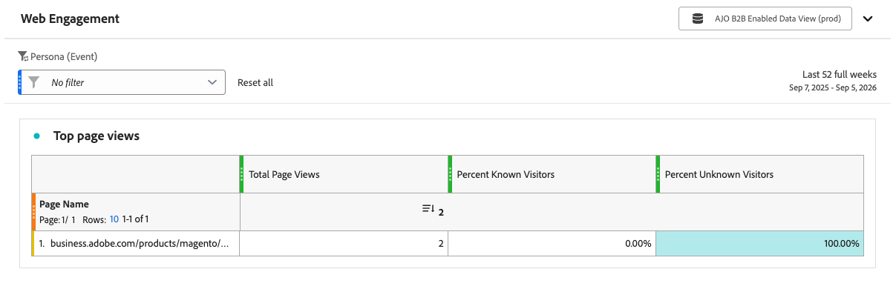
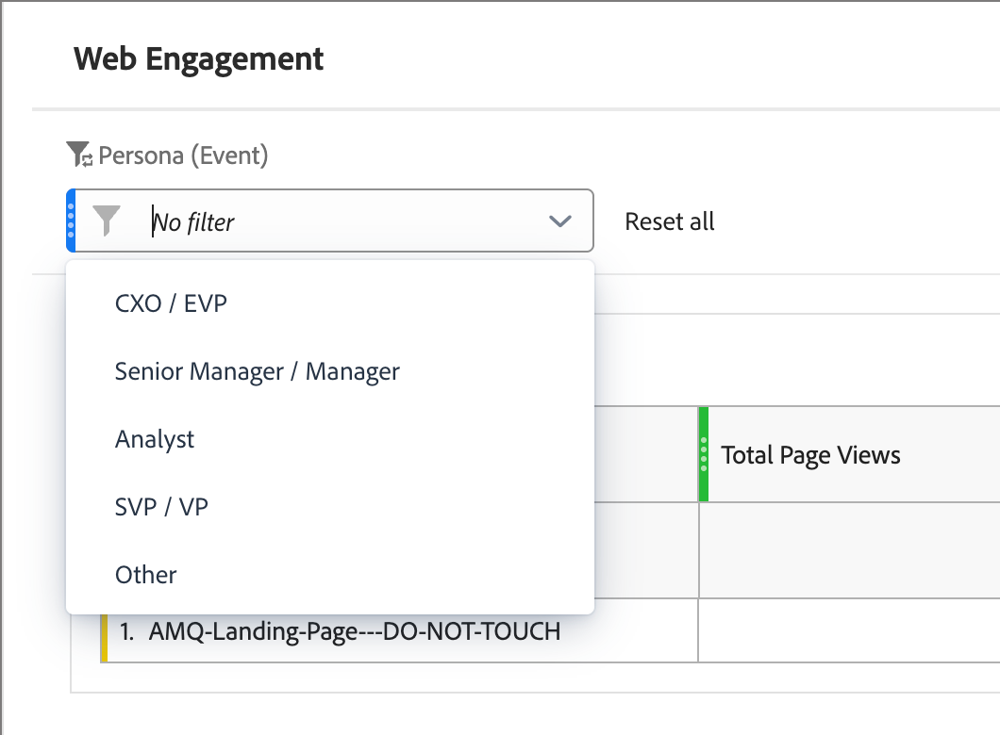

# Relatório de Envolvimento da Web

<!-- SPHR-39571: Audience, Company Name, Company Industry, and Region filters, plus the report title/subtitle rename, are planned under SPHR-32471 (not yet shipped) and should be documented separately once delivered  -->

Use o relatório [!UICONTROL Envolvimento da Web] para revisar o envolvimento dos webinários interativos mais populares em sua instância.

_Para exibir o relatório :_

1. Na navegação à esquerda, selecione **[!UICONTROL Relatórios]**.
1. Clique no ícone _Lista_ (  ) e selecione **[!UICONTROL Envolvimento da Web]** no painel _[!UICONTROL Índice]_.

{width="700" zoomable="yes"}

Você pode [alterar o intervalo de datas](./reports-overview.md#change-the-date-range) do relatório.

Selecione **[!UICONTROL Compartilhar]** na parte superior do relatório para baixar ou agendar uma exportação de todos os dados do relatório. Consulte [_Exportar um relatório_](./reports-overview.md#export-a-report) na visão geral de Relatórios.

## Tabela de relatório {#report-table}

O relatório [!UICONTROL Envolvimento da Web] mostra as 10 páginas mais visualizadas da sua instância, com a seguinte dimensão de linha.

* **[!UICONTROL Nome da Página]** - O nome da página da Web.

| Coluna | Descrição |
| --- | --- |
| [!UICONTROL Total de Exibições de Página] | Número total de exibições da página. |
| [!UICONTROL Percentual de Visitantes Conhecidos] | Porcentagem de visualizações de visitantes conhecidos. |
| [!UICONTROL Percentual de Visitantes Desconhecidos] | Porcentagem de visualizações de visitantes desconhecidos. |

## Filtros {#filters}

Use o filtro **[!UICONTROL Persona (Evento)]** na parte superior do relatório para restringir os dados de exibição de página. Abra a lista de filtros e selecione os valores que serão incluídos.

* **[!UICONTROL Persona (Evento)]** - Filtre pela [persona derivada](../audiences/personas.md#filter-by-derived-persona) associada às exibições de página. O padrão é [!UICONTROL Nenhum filtro].

{width="500" zoomable="yes"}

Selecione **[!UICONTROL Redefinir tudo]** para limpar o filtro e retornar à exibição padrão.

>[!NOTE]
>
>Os filtros para público, nome da empresa, setor da empresa e região estão planejados para uma versão futura.
